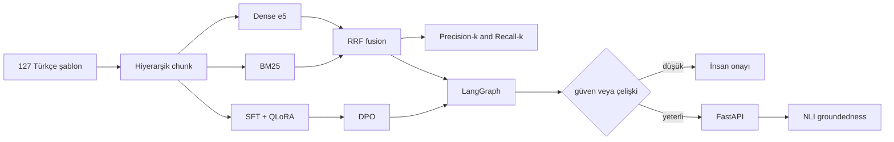

# TeknikYaz

**Türkçe teknik dokümantasyon asistanı** — hiyerarşik hibrit RAG, LangGraph çok ajanlı orkestrasyon, QLoRA/DPO, ölçülebilir retrieval ve düşük güvende insan onayı.

Taslak notları, orijinal Türkçe şablon korpusuna (README, API, kurulum, mimari…) dayandırarak düzgün belgeye çevirir. Colab/Kaggle GPU ve yerel PyTorch ile uçtan uca çalışır.

[English](#english)

<p>
  
  
  
  
  
</p>

## Ölçülen sonuçlar

Portföy ölçeği (127 orijinal belge, 146 chunk). Amaç SOTA liderboard değil; her katmanın **gerçekten çalıştığını** ve hataların nasıl yakalandığını göstermek.

| Katman | Sonuç |
|---|---|
| Retrieval, 32 gold soru, RTX 2080 | Rerank-only **P@1 0.66** → RRF fusion sonrası **P@1 1.00 / Recall@5 1.00** |
| Türkçe sınıflandırıcı (`dbmdz/bert-base-turkish-cased`) | Accuracy **0.955**, macro F1 **0.972** (sessiz etiket hatası F1 0.32 iken yakalandı) |
| QLoRA `Qwen2.5-3B-Instruct` | Eğitilebilir parametre **%0.24**, val loss 1.84 → 1.47 |
| Yerel NF4 generate (64 token, RTX 2080) | **P95 6.4 s**, 5.8 GB VRAM |
| DistilBERT öğrenci (sınıflandırıcı) | ~**%49** daha düşük gecikme |
| XAI | Base modelde 3 tekrarlanabilir halüsinasyon; NLI groundedness **0.20** ile yakalandı |

32 soruluk gold set, web-ölçeği IR değildir. Şablon niyeti ("nasıl yazılır") başlık sinyalidir, gizli etiket sızıntısı değil.

## Mimari



**Retrieval:** dense + BM25 adayları birleşir, RRF sıraları korur, cross-encoder *ek* skordur. Reranker tek hakem olunca `README Şablonu` top-5'ten düşüyordu.

**Ajanlar:** yönlendirici → retrieve → yazar → eleştirmen (çelişki + groundedness) → konsensüs → `needs_human_review`.

## Yetki, gizlilik ve izlenebilirlik

Aynı bilgi tabanını farklı rollerdeki kullanıcılar (müşteri, geliştirici, güvenlik ekibi) ve IDE ajanları (MCP) kullanır; her biri yalnızca okuma yetkisi olan belgeyi görmeli, kişisel veri ve secret hiçbir log'a düşmemeli.

| Bileşen | Ne yapar |
|---|---|
| `src/governance/acl.py` | Başlık-kural tabanlı belge sınıfı (`public` / `internal` / `restricted`) + grup şartı, **deny-by-default**. Yetkisiz adaylar dense/BM25 sonrası, **füzyon ve reranker'dan önce** düşer; aday havuzu kısıtlı kullanıcı için 3 kat genişletilir. |
| `src/governance/pii.py` | TCKN, IBAN (mod-97), kart (Luhn) **checksum doğrulamalı**; telefon, e-posta, IP; API anahtarı, JWT, `password=` gibi secret'lar. Metrik kaydı, trace, denetim kaydı ve MCP çıktısı maskelenir. |
| `src/governance/audit.py` | SHA-256 **hash zincirli** denetim kaydı (kim, ne sordu, hangi belge döndü, kaç aday reddedildi); silinen/düzenlenen satırı `verify()` yakalar. |
| `src/llmops/tracing.py` | `contextvars` ile iç içe span'ler (dense, bm25, acl_filter, rerank, fusion); OpenTelemetry'e yakın alanlar, aşama başına p50/p95. |
| `src/serving/mcp_server.py` | `search_docs`, `get_document`, `whoami` MCP araçları (salt okunur). Kimlik araç argümanı değil, sunucu ortamından gelir; yetkisiz ve olmayan belge için **aynı hata** (varlık sızdırmaz). |
| `src/serving/api.py` | `POST /search` + `/chat`: `X-User` başlığından istek-kapsamlı kimlik, ACL, denetim kaydı. |

Gerçek indeksle ölçüm (`scripts/run_acl_eval.py`, 32 gold soru, top-5, RTX 2080):

| Rol | Sızıntı | Hit@1 ACL / ACL'siz | Recall@5 ACL / ACL'siz | Yasak gold'u doğru gizleme |
|---|---|---|---|---|
| müşteri (`public`) | **0** | 1.000 / 1.000 (18 soru) | 1.000 / 1.000 | **14/14** |
| geliştirici (`internal`) | **0** | 1.000 / 1.000 (26 soru) | 1.000 / 1.000 | **6/6** |
| güvenlik (`restricted`) | **0** | 1.000 / 1.000 (32 soru) | 1.000 / 1.000 | — |

`acl_filter` aşaması **p50 0.22 ms** (retrieve toplamı p50 ~110 ms; maliyetin çoğu reranker). Gerçek stdio MCP oturumunda müşteri rolü "Güvenlik politikası…" sorusunda güvenlik belgelerini görmedi, `get_document` reddetti; güvenlik rolü aynı belgeyi aldı; denetim zinciri `verify()` ile geçerli.

```bash
python scripts/run_acl_eval.py
TEKNIKYAZ_USER=gelistirici python -m src.serving.mcp_server   # stdio MCP sunucusu
```

Sınırlar: `X-User` demo kimliğidir; üretimde doğrulanmış JWT/OIDC claim'inden gelmeli. Politika başlık-regex tabanlı (belge metadata'sında ACL alanı yok); PII tespiti desen + checksum, NER tabanlı isim/adres tespiti yok. Trace'ler JSONL'e yazılır, OTLP exporter yok. Gold set küçük; "kalite kaybı yok" sonucu bu 32 soru içindir.

## Depo

```
src/agents/          LangGraph: router, conflict, consensus
src/rag/             hybrid retrieve, RRF fusion, hierarchy, eval
src/finetune/        QLoRA
src/alignment/       DPO
src/xai/             groundedness, güven, HITL eşiği
src/optimize/        quantize / prune / distill + vLLM istemcisi
src/governance/      ACL, PII/secret maskeleme, hash zincirli denetim kaydı
src/serving/         FastAPI + Streamlit sohbet (demo / canlı)
src/nlp_tasks/       sınıflandırma, NER, özet, QA, çeviri, diyalog
notebooks/           Colab 00–08
data/eval/           retrieval gold (Precision@k / Recall@k)
docker/              API + isteğe bağlı vLLM GPU profili
```

## Kurulum

**Colab (önerilen, GPU):** [`notebooks/00_ortam_kurulumu.ipynb`](notebooks/00_ortam_kurulumu.ipynb) — Runtime → T4 GPU.

**Yerel testler:**

```bash
python -m venv .venv
# Windows: .venv\Scripts\activate
pip install -r requirements.txt
pytest tests/ -q
```

**Arayüz (önerilen demo, GPU yok):**

```bash
streamlit run src/serving/chat_app.py
```

Kenardan **Demo (GPU yok)** seçili kalsın. Örnek sorular README / API / HITL / kapsam dışı turlarını gösterir. **Canlı** mod Chroma indeksi ve yerel LLM ister.

Retrieval skor kartı (Chroma indeksi gerekir):

```bash
python scripts/run_retrieval_eval.py
```

vLLM (ayrı GPU konteyneri; imaj büyük):

```bash
docker compose --profile gpu -f docker/docker-compose.yml up vllm
python scripts/run_vllm_bench.py
```

Notebook sırası: veri → NLP görevleri → RAG → QLoRA → DPO → inference → LLMOps → XAI.

## Dürüst sınırlar

- Öğrenim / portföy sistemi; klinik production orkestratörü değil.
- DPO, SFT’nin zaten öğrendiği “yapı vs. serbest” ekseninde küçük etki gösterdi; sonraki eksen “uydurma vs. reddet” olmalı.
- vLLM istemcisi hazır; bu makinede imaj çekimi ağ hatasıyla kesildi. P95 yukarıdaki NF4 generate ölçümü.
- Gold set 32 soru, tek ilgili belge ağırlıklı — P@5’in tavanı ~0.20.

Tüm örnek belgeler bu proje için yazıldı; kazınmış veya telifli korpus yok.

---

<a id="english"></a>

## English

End-to-end Turkish LLM stack: hierarchical hybrid RAG (dense + BM25 + RRF), LangGraph agents (route / write / critique / consensus / human gate), QLoRA + DPO on Qwen2.5-3B, FastAPI, Streamlit chat (GPU-free demo mode), NLI groundedness.

Measured on a 127-document original corpus: retrieval **P@1 1.00 / R@5 1.00** on a 32-query gold set after fusion (was 0.66 P@1 with rerank-only), Turkish classifier macro-F1 **0.972**, local NF4 **P95 6.4 s** on RTX 2080. Portfolio scale, not a production clinical system — failures are documented on purpose.

Governance layer: permission-aware retrieval (document ACLs applied *before* fusion and reranking, deny-by-default), checksum-validated Turkish PII + secret redaction, hash-chained audit log, span tracing, and an MCP server whose identity comes from the server environment, not tool arguments. On the real index: **0 leaked documents** across 3 roles × 32 queries, no Hit@1/Recall@5 loss vs. no-ACL baseline, ACL filter p50 0.22 ms.

Author: [Beyza Nur Kılıç](https://github.com/l4NGEL)
